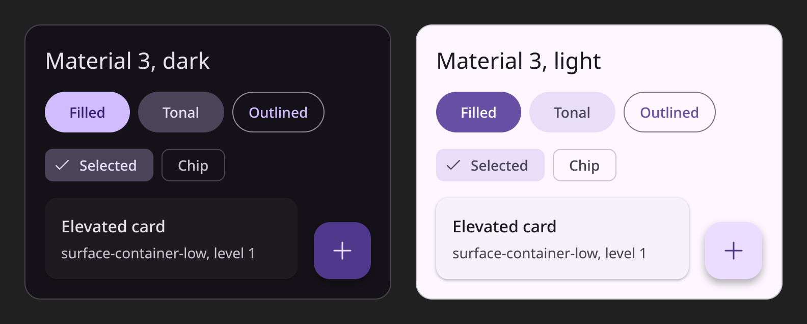

<h1 align="center">NovaUI</h1>

<p align="center">一个只重绘变化部分的 Rust 保留模式 GUI 框架。</p>

<p align="center">
  <a href="#许可证"></a>
  
  
</p>

<p align="center"><a href="README.md">English</a> | 简体中文</p>

<p align="center"></p>

NovaUI 是 [NovaPlayer](https://github.com/wuuuming/NovaPlayer) 用来绘制界面的框架。窗口的结构和外观写在
`.nui` 样式表里，状态和逻辑留在 Rust 里，元素树、布局和绘制交给 NovaUI。每次改动都会记下它让什么失效，
所以一帧只做这次改动需要的工作。画面不动的窗口完全不出帧；有东西变了，也只重绘、只呈现被改动的那一块。

它支持 Windows（Win32，D3D11 或 Vulkan）和 Linux（Wayland 或 X11，Vulkan），另有一个软件渲染器，测试里
拿它和 GPU 渲染器逐像素比对。

> [!WARNING]
> NovaUI 还很年轻，而且是在一个应用里长出来的。API 还会变，没有发布到 crates.io，现有的控件也是
> NovaPlayer 用得到的那些。请钉住一个提交使用。

## 一个小例子

外观写在 `hello.nui`：

```scss
Column #root { width: 100%; height: 100%; bg: solid-base; padding: 24; gap: 12;
  Text "Hello, NovaUI" { type: title; }
  Text #count { text: $count; fg: text-secondary; }
  Button #add { align-self: start; height: 32; padding: 0, 16; radius: radius-control;
                bg: accent; on-click: add;
    Text "Click me" { fg: black; }
  }
}
```

行为写在 Rust 里：

```rust
use novaui::dsl::{parse, Doc};
use novaui::{App, Event, NcHit, Ui};

struct Hello { doc: Doc, clicks: u32 }

impl Hello {
    fn new() -> Self {
        Hello { doc: Doc::new(parse(include_str!("hello.nui")).unwrap()), clicks: 0 }
    }
}

impl App for Hello {
    fn init(&mut self, ui: &mut Ui) {
        let root = ui.tree.root();
        self.doc.build(ui, root).unwrap();
        self.doc.set(ui, "count", "Not clicked yet.");
    }

    fn event(&mut self, ui: &mut Ui, ev: Event) {
        if let Event::Click { action: Some(a), .. } = ev {
            if a.is("add") {
                self.clicks += 1;
                self.doc.set(ui, "count", format!("Clicked {} time(s).", self.clicks));
            }
        }
    }

    fn after_layout(&mut self, ui: &mut Ui) {
        self.doc.update(ui); // the sheet's expressions follow the window and the bindings
    }

    fn nc_hit(&self, _: &Ui, _: i32, _: i32) -> NcHit {
        NcHit::Client // no custom title bar here
    }
}
```

点击会设置 `$count`，于是只有那一行文字重新布局和重绘，别的都不动。完整的例子是
[`examples/docs_hello.rs`](crates/novaui/examples/docs_hello.rs)，其余的功能可以在 gallery 里看到：

```sh
cargo run -p novaui --example docs_hello
cargo run -p novaui --example gallery
```

## 里面有什么

- `.nui` 样式表：元素、样式、变量、表达式和绑定、带参数的组件；编辑时可以原地热重载（调试构建，F12 打开检查器）。
- Flexbox 和块布局（基于 [Taffy](https://github.com/DioxusLabs/taffy)），以及不触发布局的透明度、位置、缩放和滚动动画。
- 文字：可变字体，带双向文字的排版和正确的断行，按字符的字体回退（中日韩、阿拉伯文、希伯来文、天城文、泰文），Windows、Wayland 和 X11 上的输入法。
- 控件：弹出层和菜单、虚拟列表、滚动条、文本框、开关、二维码、用 WGSL 写的图像效果，以及 89 个 Fluent 图标。
- 以令牌（token）表示的主题：WinUI 深色、Material 3 深色和浅色，或者你自己的。
- 自绘标题栏的窗口、亚克力材质、D3D11 上的 HDR 输出。
- 键盘焦点和供屏幕阅读器使用的无障碍树（[AccessKit](https://github.com/AccessKit/accesskit)），都可以不开。

## 和其他框架比

如果你在挑一个 Rust GUI 库，眼下成熟的那些多半更稳妥；了解它们也能看清 NovaUI 的位置：

- [egui](https://github.com/emilk/egui) 是即时模式，每一帧都重新描述界面，写工具非常快。NovaUI 保留一棵树，两次改动之间什么都不做，这对一个整天开着的应用很重要。
- [iced](https://github.com/iced-rs/iced) 遵循 Elm 架构，从状态重新生成视图。NovaUI 里你直接改树（或者一个绑定的值），树自己知道弄脏了什么。
- [Slint](https://github.com/slint-ui/slint) 思路最接近：外观用标记语言，逻辑用代码。Slint 编译 `.slint` 文件；NovaUI 在运行时读取 `.nui`，所以样式表可以原地重载，也可以作为样式包发布。
- [GPUI](https://github.com/zed-industries/zed/tree/main/crates/gpui) 是 Zed 的框架，为 GPU 上的代码编辑器而生。NovaUI 为媒体应用而生，优先照顾 Windows 上的桌面观感。

目前还不支持 macOS、移动端和 Web。如果你需要，欢迎提 issue 或直接发拉取请求。

## 开始使用

```toml
[dependencies]
novaui = { git = "https://github.com/wuuuming/NovaUI", rev = "<full commit hash>" }
```

需要 Windows 10 / 11，或带 Wayland 或 X11 的 Linux。Linux 上的 `libwayland-client`、`libxkbcommon`、`libX11`
和 Vulkan 驱动都在运行时加载，构建时一个都不需要。

[文档站](https://wuuuming.github.io/NovaUI/zh-cn/) 有指南、每个元素和控件一页（附实时截图）、全部图标和主题说明。
它背后是 [规格](docs/novaui-spec.md)（元素、布局、文字、`.nui`、后端）、[运行时规则](docs/runtime.md)（事件、顺序、
所有权、性能）和 [地图](docs/map.md)（各部分在哪），均为英文。

## 参与

欢迎提 issue 和拉取请求；请先阅读 [CONTRIBUTING.md](CONTRIBUTING.md)（英文）。

## 许可证

在 [Apache-2.0](LICENSE-APACHE) 和 [MIT](LICENSE-MIT) 中任选其一。`crates/nova-icons` 里的 Fluent UI System
Icons 轮廓保留其 MIT 许可（[`assets/LICENSE`](crates/nova-icons/assets/LICENSE)）。

中英文版本如有出入，以英文版为准。
